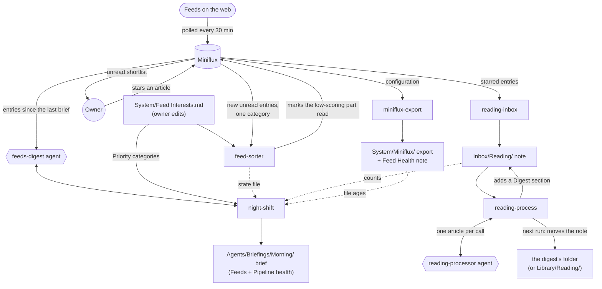

# obsidian-vault: the reading pipeline

An operator's guide to the CronJobs that connect the feed reader (Miniflux, `selfhosted/miniflux`)
to the Obsidian vault: a sorter that thins out one high-volume category, an inbox that turns
starred articles into notes, an agent that writes a digest into each note, the Feeds and
Pipeline health sections of the morning brief, and a nightly export of the reader's
configuration.

The same HelmRelease (`vault-jobs`, in `jobs/`) also runs the other vault jobs (`snapshot`,
`nightly`, `weekly-review`, `voice-inbox`, `nightwatch`); the Syncthing hub is the
`obsidian-vault` HelmRelease in `app/`. They are not covered here.

> **The scripts are moving.** The job scripts are being moved out of this repository into a
> private one that builds an image (`dapperdivers/vault-jobs`). This guide therefore names jobs,
> environment variables and vault paths, which stay the same, and keeps file paths to
> [Where the code lives](#where-the-code-lives). If a path there is gone, the move has happened.

## How an article moves



1. **Sort.** Twice an hour `feed-sorter` scores the new unread entries of one Miniflux category
   (`SORT_CATEGORY`, "Security firehose") against the owner's profile note and marks the
   low-scoring part read. Other categories are never touched. Marking read is all it does:
   nothing is deleted, starred or unsubscribed, and a read entry stays in Miniflux's History.
2. **Shortlist.** What is still unread in that category is the shortlist, for the owner and for
   the morning brief.
3. **Star.** The owner stars an article in Miniflux, from any category. That is the "keep this"
   signal, and it also feeds the sorter's scoring.
4. **Inbox note.** Within 15 minutes `reading-inbox` writes one note per newly starred entry
   under `Inbox/Reading/`, with the link, the feed and the article text.
5. **Digest.** At the next hourly run `reading-process` sends each unprocessed note to the kagent
   `reading-processor` agent and inserts a `## Digest` section above `## My notes`: summary, why
   it matters, related notes, a suggested folder, ideas worth a note of their own. The hourly run
   after that **files the note**: it moves it out of `Inbox/Reading/` into the folder the digest
   names (`Library/Reading/` when it names none), sets `status: active`, adds `filed: <date>` and puts the folder's tag first in its tags when
   the vault note `System/Folder Tags.md` lists one for that folder.
   Nobody reviews the move: a starred article counts as read.
6. **Morning brief.** At 04:30 `night-shift` asks the kagent `feeds-digest` agent for the
   entries worth reading since the last successful brief and writes them under "Feeds". It also
   writes "Pipeline health" from the files the jobs above leave in the vault.
7. **Export.** At 01:30 `miniflux-export` copies the reader's configuration into the vault and
   writes the Feed Health note. It is a side branch: nothing else depends on it, but it is the
   only copy of the configuration outside the Miniflux database.

## Jobs

All are controllers of the `vault-jobs` HelmRelease in `selfhosted`; the CronJob is named
`vault-jobs-<job>`. Schedules are in `${TIME_ZONE}` from the cluster settings
(`America/Chicago`). Every job has `concurrencyPolicy: Forbid`, keeps one successful and two
failed Jobs, skips a vault that has no `.stfolder` marker (not synced yet), and asks the
Syncthing hub for a rescan after writing.

| Job               | Schedule                                      | Reads                                                                                                                | Writes                                                                                                                                                                                                 | Calls                                                                                                                          | If it fails                                                                                                                                                                                         |
| ----------------- | --------------------------------------------- | -------------------------------------------------------------------------------------------------------------------- | ------------------------------------------------------------------------------------------------------------------------------------------------------------------------------------------------------ | ------------------------------------------------------------------------------------------------------------------------------ | --------------------------------------------------------------------------------------------------------------------------------------------------------------------------------------------------- |
| `feed-sorter`     | `10,40 * * * *` (deadline 25 min)             | The profile note; unread entries of `SORT_CATEGORY` after its high-water mark; the 200 most recently starred entries | Entry status `read` in Miniflux; its state file, decisions file and the Feed Sorter Review note                                                                                                        | Miniflux API (GET, and PUT for the status); Ollama `/api/embed` with `EMBED_MODEL` (`embeddinggemma`)                          | Nothing is marked and the high-water mark does not move. Entries stay unread and the next good run works the backlog off, oldest first.                                                             |
| `reading-inbox`   | `*/15 * * * *` (deadline 10 min)              | The 200 most recently starred entries; its ledger                                                                    | One note per new starred entry (at most 20 a run) and the ledger, under `Inbox/Reading/`                                                                                                               | Miniflux API, GET only                                                                                                         | Stars are untouched, so the next run picks the same entries up.                                                                                                                                     |
| `reading-process` | `40 * * * *` (deadline 55 min)                | Notes in `Inbox/Reading/` with `type: article` and no `processed:` that have not been edited for 5 minutes           | A `## Digest` section, `processed: <date>` and extra tags in the note (at most 5 notes a run); its attempts ledger. With `READING_AUTOFILE`, digested notes moved to their folder and its filed ledger | kagent agent `reading-processor` (`READING_AGENT_URL`), which reads the vault through the read-only `vault` tool server        | A failed article is counted and retried on later runs; after three failures it is left alone. On a usage limit the run stops and succeeds; nothing is counted.                                      |
| `night-shift`     | `30 4 * * *` (deadline 90 min, budget 75 min) | The profile note's "Priority categories"; the brief topics note; the files of the other jobs (for Pipeline health)   | `Agents/Briefings/Morning/<date>.md` and `ledger.json` beside it                                                                                                                                       | kagent agents `feeds-digest` (`FEEDS_AGENT_URL`), `security-brief` (`SECURITY_AGENT_URL`), `night-editor` (`CLAUDE_AGENT_URL`) | A failed section becomes a line under "Problems" and the brief is still written. The Feeds window only moves forward after a usable answer, so the next night covers the gap (up to 72 hours back). |
| `miniflux-export` | `30 1 * * *` (deadline 15 min)                | Miniflux settings, categories, feeds, OPML export, entry counts                                                      | `System/Miniflux/feeds.opml`, `System/Miniflux/miniflux-config.json`, `Agents/Generated/Feed Health.md`, each only when it changed                                                                     | Miniflux API, GET only                                                                                                         | The previous export stays as it was. Fails on purpose when Miniflux has fewer than half the feeds of the last export (see the runbook).                                                             |

Notes on the table:

- `night-shift` does much more than feeds (security section, topic sections, vault research).
  Only its Feeds and Pipeline health parts belong to this pipeline. The `feeds-digest` agent
  reads Miniflux through the `miniflux` tool server (`kagent/miniflux-mcp`); the job itself never
  talks to Miniflux.
- Kubernetes retries a failed run (`backoffLimit` is 6 on the live CronJobs) until the Job's
  deadline. A CronJob whose last run failed raises the
  `CronJobLastRunFailed` alert after 15 minutes; it clears on the next successful run.
- `feed-sorter`, `reading-inbox` and `miniflux-export` read the Miniflux API key from the Secret
  `obsidian-vault-miniflux-secret` (ExternalSecret `obsidian-vault-miniflux`, Infisical key
  `MINIFLUX_API_KEY`).
- The agents run on the Claude subscription and share its usage limits with every other Claude
  agent in `kagent`. See `kubernetes/apps/kagent/README.md` for the agents themselves.

## Files in the vault

Paths are relative to the vault root. "Generated" files are overwritten by their job: do not
edit them.

| Path                                          | Owner                                                                                                                                                                 |
| --------------------------------------------- | --------------------------------------------------------------------------------------------------------------------------------------------------------------------- |
| `System/Feed Interests.md`                    | **The owner edits it.** `feed-sorter` writes a starter once, when the note does not exist, and never touches it again.                                                |
| `System/Morning Brief Topics.md`              | **The owner edits it.** One brief section per `## Heading`, with the instructions for that section as its body. `night-shift` only reads it.                          |
| `Inbox/Reading/<date> <title>.md`             | Created by `reading-inbox`. `reading-process` adds the Digest, then moves the note to the digest's folder (`status: active`, `filed:`). `## My notes` is the owner's. |
| `Inbox/Reading/ledger.json`                   | Generated by `reading-inbox`: Miniflux entry id to the note it wrote, so a filed or deleted note is not written again.                                                |
| `Inbox/Reading/process-ledger.json`           | Generated by `reading-process`: failed attempts per note file name.                                                                                                   |
| `Inbox/Reading/filed-ledger.json`             | Generated by `reading-process`: where each note was moved and when (30 days). The morning brief counts filed notes from it.                                           |
| `Agents/Generated/feed-sorter-state.json`     | Generated by `feed-sorter`: calibration, `last_id`, `last_run`, per-day counts for 14 days.                                                                           |
| `Agents/Generated/feed-sorter-decisions.json` | Generated by `feed-sorter`: one row per entry handled in the last 14 days (at most 5000).                                                                             |
| `Agents/Generated/Feed Sorter Review.md`      | Generated by `feed-sorter` on its first run of each day.                                                                                                              |
| `System/Miniflux/feeds.opml`                  | Generated by `miniflux-export`: the subscriptions.                                                                                                                    |
| `System/Miniflux/miniflux-config.json`        | Generated by `miniflux-export`: user settings, category flags, per-feed options. Never feed credentials.                                                              |
| `Agents/Generated/Feed Health.md`             | Generated by `miniflux-export`.                                                                                                                                       |
| `Agents/Briefings/Morning/<date>.md`          | Generated by `night-shift`.                                                                                                                                           |
| `Agents/Briefings/Morning/ledger.json`        | Generated by `night-shift`; `feeds_since` is when the feeds were last read successfully.                                                                              |

### The profile note

`System/Feed Interests.md` holds bullets under `##` headings. Only bullets count; other lines,
and bullets still carrying the starter's `(replace me)` marker, are ignored.

| Section                  | Read by       | Meaning                                                                                                                    |
| ------------------------ | ------------- | -------------------------------------------------------------------------------------------------------------------------- |
| `## Interests`           | `feed-sorter` | One topic per bullet, in the words an article about it would use. An entry is scored by its nearest interest.              |
| `## Noise`               | `feed-sorter` | Kinds of entry to push down, for example "webinar invitation, product launch".                                             |
| `## Watchlist`           | `feed-sorter` | Names matched as whole words (three characters or more). An entry that mentions one is always kept, whatever its score.    |
| `## Priority categories` | `night-shift` | Miniflux category names, at most 10. The digest reads these first and completely, and lists what it picks from them first. |

Until the note has at least one real interest the sorter does nothing.

## Tuning

**How the sorter decides.** For each new entry it first checks, in this order: a watchlist hit
(kept), a title already seen in the category this week (read, "duplicate"), non-English text
(read). Everything else is scored from the title and the start of the text: similarity to the
nearest interest, plus similarity to the three nearest starred articles, minus similarity to
the nearest noise bullet. Each part is standardised against a 30-day sample of the category, and
the cut-off is the `READ_BELOW_PCT` percentile of that sample.

**Change the cut-off.** `READ_BELOW_PCT` on the `feed-sorter` controller in the HelmRelease
(now `"50"`): higher marks more entries read, lower keeps more. It is a pull request, not a
vault edit.

**Edit the profile.** Change the bullets from any device; the note is read on every run. Add or
reword an interest for something that should have been kept, add a noise bullet for something
that should not. A watchlist change applies on the next run with no recalibration.

**What triggers recalibration.** The 30-day sample is re-measured when the Interests bullets,
the Noise bullets or `READ_BELOW_PCT` change, and otherwise every 7 days. The log line is
`calibrated on N entries; cut-off ...`. With fewer than 50 entries in the sample the sorter
marks nothing. Overriding `READ_BELOW_PCT` in a one-off Job therefore recalibrates twice: once
for that run, and again on the next scheduled run.

**Read the Feed Sorter Review note.** It is rewritten once a day and covers yesterday onwards:

- The line under the header gives the current cut-off score.
- **Counts**: new, kept by score, kept by watchlist, and read as low score, duplicate or
  non-English, for yesterday and the last 7 days. This is the place to see what share is
  actually being removed.
- **Misses**: entries you starred that the sorter had marked read or scored below today's
  cut-off. Each one is an argument for a new or reworded interest. To produce one on purpose,
  find a marked-read entry in Miniflux's History and star it.
- **Top kept**: the highest scores left unread. Junk here wants a noise bullet.
- **Borderline**: marked read, closest below the cut-off. If these look worth reading, the
  cut-off is too high or an interest is missing.
- **Other marked read**: a sample across the rest. It should look uninteresting.

Scores are standardised against the sample, so only their order and their distance from the
cut-off mean anything. Watchlist, duplicate and non-English rows show `n/a`.

**Other knobs** (environment variables with defaults in the code, none set in the HelmRelease
today): `SORT_MAX_PER_RUN` (1500 entries a run), `SORT_WINDOW_HOURS` (3, first run only),
`READING_PER_RUN` (20), `READING_MAX_CHARS` (40000), `READING_PROCESS_PER_RUN` (5),
`READING_MIN_AGE_S` (300), `READING_AUTOFILE` (true here; unset means no filing), `READING_FILE_FALLBACK` (`Library/Reading`), `FEEDS_MAX_ITEMS` (12), `FEED_STALE_DAYS` (90).

## Checking health

**In the vault.** Three places, in the order to look:

1. **"Pipeline health" in the morning brief.** Built from vault files only, so it is there even
   when every agent call failed. It says "All well", or carries a warning (repeated under
   "Problems") when:
   - the sorter's state file is missing or unreadable, or records no last run;
   - the sorter has handled no new entry for more than 3 hours (a category that was simply
     quiet for 3 hours looks the same);
   - an article note has been waiting more than 3 hours for its digest;
   - `reading-process` gave up on a note after three attempts;
   - `System/Miniflux/miniflux-config.json` is missing, or none of the export's files changed
     for 36 hours.
2. **Feed Sorter Review** for the sorter's calls (above).
3. **Feed Health** for the reader itself: totals, feeds with parsing errors, enabled feeds whose
   newest entry is older than 90 days, enabled feeds with no entries, and the busiest feeds of
   the last 7 days.

**In the cluster.**

```sh
# Last schedule and last success of every vault job
kubectl get cronjob -n selfhosted -l app.kubernetes.io/name=vault-jobs

# Runs still kept for one job (one successful, two failed), and their logs
kubectl get jobs -n selfhosted -l app.kubernetes.io/controller=feed-sorter
kubectl logs -n selfhosted -l app.kubernetes.io/controller=feed-sorter --tail=100 --prefix

# The agents the pipeline calls
kubectl get agents -n kagent reading-processor feeds-digest
```

Each job ends with a one-line summary (`feed-sorter: 40 new; 12 left unread by score, ...`,
`reading-process: 2 processed, 0 left for the next run`), which is usually all you need.

## Runbook

### A job succeeds but does nothing

Each of these is a normal exit with a line in the log, not an error:

- `has no .stfolder marker`: the vault volume is empty or not synced. Look at the Syncthing hub.
- `MINIFLUX_URL / MINIFLUX_API_KEY not set` or `READING_AGENT_URL not set`.
- `writing a starter System/Feed Interests.md` or `has no interests yet`: the profile note
  needs editing.
- `no Miniflux category named ...`: the category was renamed in Miniflux. `SORT_CATEGORY` and
  `SORTED_CATEGORY` (one YAML anchor in the HelmRelease) must match its title exactly.
- `too few to calibrate, nothing marked`: fewer than 50 entries in the category in 30 days.

### A job fails at start (import error, or the HelmRelease will not upgrade)

Two failures `kustomize build` cannot see: a script that dies on import in the pod
(`ModuleNotFoundError`, because the jobs run `python3 -I`), and values the app-template schema
rejects (the HelmRelease upgrade fails and rolls back, so the CronJobs keep their old spec).
Both are now checked on every pull request that touches the app by the "Obsidian Vault"
workflow, which runs unit tests, starts every script the way its CronJob does, and renders the
chart. Run the same locally before pushing:

```sh
scripts/check-obsidian-vault.sh   # or: task kubernetes:check-obsidian-vault
```

If it happens anyway: read the pod log for the traceback, check
`flux get hr -n selfhosted obsidian-vault`, and revert the offending commit. The data jobs are
safe to miss runs: each resumes from its own ledger or high-water mark.

### An agent hits its usage limit

The Claude agents share one subscription. `reading-process` logs
`usage limit, stopping`, exits successfully and counts no attempt; it tries again next hour.
`night-shift` stops at the first refusal and writes the brief with a "Stopped early" warning
at the top; every later section is missing that day, Pipeline health is still there. Nothing
needs doing except waiting for the limit to reset. If it keeps happening, look at what else
uses the subscription: `voice-inbox` and `night-shift` call Claude agents too, as does anyone
using them interactively.

### An agent or the kagent controller is down

`reading-process` treats any other failure (connection refused, timeout, bad JSON, agent error)
as a failed attempt for that note. An outage that spans three runs therefore makes it give up
on up to five notes; see "An article is stuck unprocessed" to release them. `night-shift`
records each failed section under "Problems".

Check `kubectl get agents -n kagent`. If the agents are Ready but calls time out, the caller
may not be admitted: the `kagent-controller` CiliumNetworkPolicy lists the vault job
controllers allowed in (`voice-inbox`, `night-shift`, `nightwatch`, `reading-process`). A new
job that calls an agent must be added there.

### Ollama is unavailable

Only `feed-sorter` needs it in this pipeline (embeddings from `OLLAMA_URL`). The run fails
before anything is marked read, so nothing is lost: entries pile up unread. Until it is back,
the unread shortlist and the Feeds section of the brief see that category unsorted. Check that
the Ollama instance is up and still has the `EMBED_MODEL` model.

### The sorter is catching up after an outage

The sorter remembers the highest entry id it handled (`last_id`) and asks for unread entries
after it, oldest first, at most `SORT_MAX_PER_RUN` (1500) a run. After an outage it works the
backlog off over the following runs and logs `N more wait for the next run` until it is level.
Nothing is skipped and there is nothing to do. To go faster, run it by hand between schedules
(below). Entries less than a minute old are left for the next run on purpose.

### An article is stuck unprocessed

Open the note and the log of `reading-process`, then check in this order:

1. **Edited recently.** A note touched in the last 5 minutes is skipped, and a note that changed
   during the agent call is retried next run (`changed while it was being processed`).
2. **Backlog.** Five notes a run, in file-name order. The summary line says how many are left.
3. **Given up.** Three failed attempts (`attempt 3 of 3` in an earlier log). Delete the note's
   entry from `Inbox/Reading/process-ledger.json`, or delete the file to release every note.
4. **Not an inbox article any more.** The job only looks at notes directly in `Inbox/Reading/`
   with `type: article` in the frontmatter. A note that was moved or lost its frontmatter is
   out of scope.
5. **Half-processed by hand.** To redo a digest, remove both the `processed:` line and the
   whole `## Digest` section. With only the Digest removed the note is skipped; with only
   `processed:` removed the agent is called every hour and nothing is written (the log says
   `changed while it was being processed`).
6. **The agent's answer is rejected every time.** The job drops related notes and folders that
   do not exist and quotes that are not in the article, but an answer with no summary, or no
   JSON at all, is a failure. Usually the article text is the problem (a page that would not
   scrape). The job stops by itself after the third attempt.

A starred article with no note at all is a `reading-inbox` question: it considers only the 200
most recently starred entries and skips any entry id already in `Inbox/Reading/ledger.json`
(that is what stops a filed or deleted note coming back). Remove the id from the ledger to
have the note written again.

### The export's shrink guard fires

`miniflux-export` fails every night with
`Miniflux has N feeds but the last export has M; refusing to overwrite it` when the live
instance has fewer than half the feeds of the last export (and that export had at least 10).
This is the intended behaviour after Miniflux was rebuilt empty: the good export is protected
until the feeds are back.

- **Rebuilt instance:** restore first (next section). The job succeeds again once the feed
  count is back above half.
- **The drop is intended** (you really removed most of the feeds): run the export once with
  `--force`. That is a command-line flag, not an environment variable, so the one-off Job needs
  its arguments replaced; see the last example below.

### Run a job once by hand

```sh
kubectl create job -n selfhosted --from=cronjob/vault-jobs-reading-process reading-process-manual
kubectl logs -n selfhosted job/reading-process-manual -f
kubectl delete job -n selfhosted reading-process-manual
```

A Job made this way keeps the pod labels of the CronJob, so the network policies still admit
it. `concurrencyPolicy: Forbid` does not apply to it: do not start one while the scheduled run
is due or running.

To override an environment variable for one run, edit the Job before creating it. This sets
`READING_PROCESS_PER_RUN` whether or not the CronJob already has it:

```sh
kubectl create job -n selfhosted --from=cronjob/vault-jobs-reading-process reading-process-manual \
  --dry-run=client -o json \
  | jq '.spec.template.spec.containers[0].env |= (map(select(.name != "READING_PROCESS_PER_RUN")) + [{"name": "READING_PROCESS_PER_RUN", "value": "20"}])' \
  | kubectl create -f -
```

Flags (`--dry-run` on every job, `--force` on the export) go in the container's arguments
instead. The arguments are the job's name; the image's entrypoint passes whatever follows a
`--` on to the script, for every vault:

```sh
kubectl create job -n selfhosted --from=cronjob/vault-jobs-miniflux-export miniflux-export-force \
  --dry-run=client -o json \
  | jq '.spec.template.spec.containers[0].args = ["miniflux-export", "--", "--force"]' \
  | kubectl create -f -
```

## Restoring Miniflux from the export

> **Warning: the restore mode has not been run against a real instance.** `--restore-plan` is
> read-only and safe to try. `--restore` creates and updates through the Miniflux API, and this
> repository has no tests for it beyond checking that the script starts. Read the plan before
> applying it, and expect to finish some of it by hand.

Miniflux keeps all its state in Postgres. If the database or a backup of it survives, restore
that: it brings back entries, read state and stars, which the export does not hold. The export
is for when the database is gone. It holds the subscriptions (`feeds.opml`) and what OPML does
not carry (`miniflux-config.json`: user settings, category flags, per-feed options). It never
holds feed usernames, passwords, cookies or proxy URLs, only the names of the ones that were
set.

The procedure, as documented in the export script:

1. Log in to the new instance and create an API key (Settings, API Keys).
2. From any machine that has the vault and can reach Miniflux, for example through
   `kubectl port-forward -n selfhosted svc/miniflux 8080:8080`:

   ```sh
   export MINIFLUX_URL=http://127.0.0.1:8080 MINIFLUX_API_KEY=<the new key>
   python3 miniflux-export.py --restore-plan <vault>      # look at what it would do
   python3 miniflux-export.py --restore <vault> --yes
   python3 miniflux-export.py --restore-plan <vault>      # should now report no differences
   ```

   `<vault>` is the vault folder on that machine. The script needs its helper module
   (`vaultlib.py`) beside it and nothing outside the Python standard library. The plan prints
   feed titles and URLs: run it in a terminal, never as a CronJob.

3. Re-enter by hand whatever the last plan still lists: feed credentials and any option the API
   did not accept.
4. Put the new API key in Infisical as `MINIFLUX_API_KEY`, so the vault jobs and the `miniflux`
   tool server pick it up and the nightly export resumes. Until the restore is done the nightly
   run fails on purpose rather than overwrite the export with an empty one.

What a restore does: creates missing categories, imports only the missing feeds from the OPML,
then sets category flags, feed options and user settings. It never deletes, and it leaves
alone feeds and categories that exist in Miniflux but not in the export. `--restore` refuses to
run without `--yes` and exits non-zero if anything failed or still differs.

After a rebuild with a new database, entry ids start again from the beginning. This follows
from the code and has not been tested either:

- `feed-sorter` only asks for entries after `last_id`, so it would see nothing new for a long
  time. Delete `Agents/Generated/feed-sorter-state.json`; the next run recalibrates and starts
  from the last 3 hours. It marks nothing until the category has 50 entries again.
- `reading-inbox` skips entry ids that are in its ledger, and new ids will collide with old
  ones. Empty `Inbox/Reading/ledger.json`.

## Privacy

This repository is public; the vault is not. The rule for anything added to this pipeline:

- **What the owner reads and cares about lives in the vault**: interests, noise, watchlist and
  priority categories in the profile note, brief topics in the topics note, the feed list in
  the export. None of it belongs in a manifest, a script, a test fixture, a commit message or a
  pull request. Use made-up examples.
- **Keys live in secrets**: the Miniflux API key comes from Infisical through an ExternalSecret,
  the Syncthing API key from the SOPS-encrypted Secret.
- **Job logs are not private.** They leave the pod and are kept with the rest of the cluster's
  logs. The jobs are written accordingly: the sorter logs titles and feed names but never
  watchlist names, the export and the brief log counts only. Keep new log lines to that
  standard.
- The one name in Git is the sorted category's title, because the sorter and the brief both
  need it as configuration.

## Where the code lives

Today, in this repository:

- CronJobs, schedules and environment: `jobs/helmrelease.yaml`.
- Scripts: `app/resources/`, one per job with the job's name (`night-shift.py` for the brief),
  plus the shared helper `vaultlib.py`. They are mounted from the `vault-scripts` ConfigMap,
  which `app/kustomization.yaml` generates. Each script's docstring is its reference.
- Tests: `app/tests/`, run by `scripts/check-obsidian-vault.sh` and
  `.github/workflows/obsidian-vault.yaml`.
- Agents: `kubernetes/apps/kagent/kagent/agents/` (`reading-processor.yaml`,
  `feeds-digest.yaml`).

After the move to `dapperdivers/vault-jobs`, expect the scripts and tests there and only the
HelmRelease here. Update this section, and the one-off `--force` example above, when that lands.
